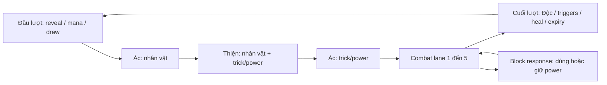
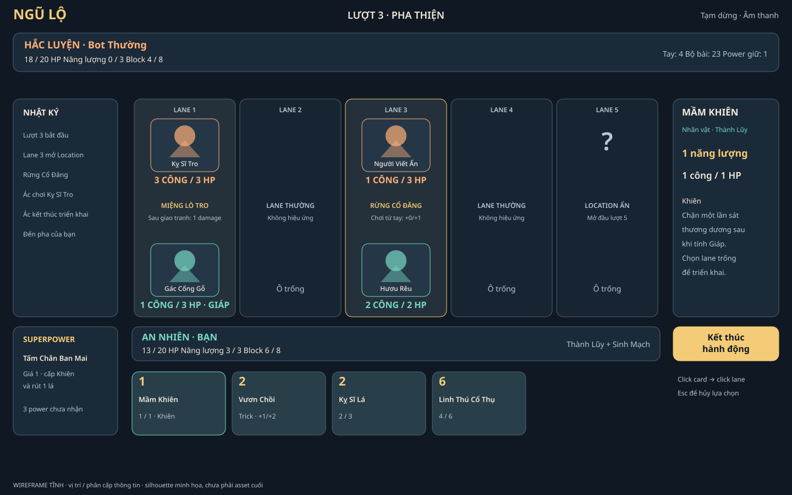

# Ngũ Lộ — Bình Minh & Tro Tàn

**Product & Technical Specification v1.1 — đề xuất bổ sung, 2026-10-20**

Trạng thái: baseline thiết kế từ các lựa chọn người dùng đã chấp thuận; các chi tiết triển khai do người thiết kế chốt được ghi riêng. **Chưa implement game.** Balance, animation performance, accessibility runtime và vận hành chưa được chứng minh.

## 1. Mục tiêu

Tạo web card battler PvE có 5 lane, hai phe thiện–ác với nhiều hero, phase bất đối xứng, superpower có bản sắc và Location reveal làm thay đổi quyết định đặt quân. Trải nghiệm ưu tiên đọc rõ luật và cảm giác ra đòn tốt; trận mục tiêu 5–10 phút, chơi trên desktop/laptop và tablet ngang.

Tên “Ngũ Lộ” là tên làm việc. Art fantasy cách điệu, nội dung gốc. PvZ Heroes chỉ là nguồn tham khảo hệ pha/hero/power; game không dùng nhân vật, hình ảnh, âm thanh hay card text của thương hiệu đó.

## 2. Cách đọc bộ tài liệu

| Tài liệu | Nội dung có thẩm quyền |
|---|---|
| [DECISIONS](docs/DECISIONS.md) | Yêu cầu được duyệt, giả định người thiết kế, ràng buộc |
| [RULES](docs/RULES.md) | R01–R22: thuật ngữ, timing, combat, win/loss, lifecycle |
| [EFFECTS](docs/EFFECTS.md) | Target, primitive, duration, trigger và event contract |
| [CONTENT](docs/CONTENT.md) | Thế giới, class, hero, 18 power, token, Location |
| [CARDS](docs/CARDS.md) | 60 card thường với chỉ số và text |
| [DECKS](docs/DECKS.md) | 6 deck hợp lệ và bot policy |
| [UI–MOTION](docs/UI-MOTION.md) | Screens, controls, art, motion, accessibility, budgets |
| [ARCHITECTURE](docs/ARCHITECTURE.md) | Stack, package boundaries, API, commands, security |
| [API-CONTRACT](docs/API-CONTRACT.md) | Payload/schema JSON chính xác, action/view/event/error và rematch |
| [TUTORIAL](docs/TUTORIAL.md) | 8 bước GOOD + 2 bước EVIL, fixture và expected state |
| [SCREENS](docs/SCREENS.md) | Hero/deck/block/result, 8 mockup desktop/tablet và behavior |
| [DATA](docs/DATA.md) | Schema, transactions, guest/account, retention |
| [BALANCE](docs/BALANCE.md) | Mô phỏng, playtest, metrics, release content |
| [ACCEPTANCE](docs/ACCEPTANCE.md) | Cases và tiêu chí nghiệm thu |
| [Kế hoạch triển khai](docs/superpowers/plans/2026-10-20-ngulo-implementation.md) | Milestones tuần tự, task/files/interfaces/checks |
| [PROGRESS](docs/PROGRESS.md) | Trạng thái milestone tài liệu |
| [VERIFICATION](docs/VERIFICATION.md) | Kiểm tra đã thực hiện, giới hạn, kết quả review |
| [REFERENCES](docs/REFERENCES.md) | Tham khảo PvZ Heroes, so sánh stack và nguồn kỹ thuật |

Nếu có mâu thuẫn: yêu cầu mới của người dùng → DECISIONS đã duyệt → RULES/EFFECTS cho ngữ nghĩa → CONTENT/CARDS cho con số → UI/mockup/plan. Phát hiện mâu thuẫn phải sửa bộ tài liệu, không tự chọn ngầm. Bản v0.1 trong reference chỉ để truy nguyên, không phải requirement hiện hành.

## 3. Luật đã chốt

| Hạng mục | Baseline |
|---|---|
| Mode | PvE online, tutorial + skirmish, hai mức bot |
| Hero | 6;3 GOOD,3 EVIL; mỗi hero 2 trong3 class của phe |
| Board | 5 lane, một quân mỗi phe mỗi lane |
| Location | 3 ID khác nhau ở lane1/3/5; reveal đầu global turn1/3/5 |
| Lane thường | 2/4; không có effect Location |
| Environment Card | Không tồn tại; không thay/xóa Location |
| Victory | Hero địch≤0 sau atomic root; simultaneous lethal hòa |
| Deck | 30 lá thường, tối đa2 bản;22 ID hợp lệ/hero |
| HP/energy | Hero20; energy1→10, refill mỗi turn |
| Hand | Bắt đầu4; mulligan một lần; draw1 từturn2; cap10 |
| Superpower | 4/hero, khay riêng; một random đầu trận |
| Block | 8 charge, +2/đòn hợp lệ; tối đa3; cấp power chưa nhận |
| Power response | Dùng ngay miễn phí hoặc giữ để dùng1 mana đúngpha |
| Combat | Theo lane1→5; EVIL animation trước, damage pair trao đổi nguyên tử |
| Deck exhaustion | Fatigue1,2,3…; không random thua |
| Turn limit | Hòa sau end-turn20 nếu chưa có kết quả |
| Progression | Toàn bộ nội dung mở; không shop/unlock grind |

Chuỗi pha:

Các terminal condition có thể dừng chuỗi tại checkpoint theo RULES. Sơ đồ không thay thế thứ tự atomic resolution.

## 4. Phạm vi nội dung

60 card =38 UNIT+22 TRICK;18 definition superpower =12 class+6 signature;6 hero;8 Location;3 token (1 chỉ tutorial). Sáu deck mẫu đều15 ID×2. Mỗi phe có3 class×8 card +6 card chung phe. Không có card chung xuyên phe.

Roster: An Nhiên, Lam Vệ, Mộc Dao; Hắc Luyện, Dạ Vũ, Mặc Ảnh. Mỗi hero có chiến thuật và 4 power rõ; không thêm passive hero thứ hai. Ability UNIT có thể trigger theo luật, không bị giới hạn bởi việc hero không có passive.

## 5. Trải nghiệm và frontend

React+TypeScript+Vite cho giao diện; PixiJS cho nhân vật/VFX; GSAP điều phối motion; semantic DOM giữ text/input/keyboard. Card trên tay và deck builder đầy đủ; nhân vật2D trên board có idle/attack/hit/death.

Legal target highlight, click/tap và drag, inspect card/Location/power, log, trạng thái chờ/mất mạng và pause là yêu cầu v1. Không hidden info trong DOM, network, asset preload theo assignment hoặc analytics.

Mockup:

[Tablet ngang](docs/design/battle-tablet.png) · [Cấu trúc card](docs/design/card-anatomy.png)

Các hình thể hiện bố cục/phân cấp, không phải asset hoàn thiện. Motion có storyboard và budget trong UI-MOTION; không có animation runtime trong bộ tài liệu.

Đề xuất màn hình bổ sung: [chọn hero](docs/design/hero-select-desktop.png), [deck builder](docs/design/deck-builder-desktop.png), [block response](docs/design/block-response-desktop.png), [kết quả](docs/design/result-desktop.png). Mỗi màn hình có bản tablet trong SCREENS.

## 6. Kiến trúc và Neon

Pure engine TypeScript tách khỏi UI/DB. Node+Fastify giữ luật/bot và cung cấp HTTP commands. Neon Postgres qua Drizzle/pg lưu durable state. Mỗi command idempotent và transaction atomic; resume không phụ thuộc server RAM.

Google qua Neon Auth; guest/session do app quản lý. Vite static build và API cùng origin ở bản đầu. Hosting mục tiêu Render Singapore, Neon Singapore; chưa có dịch vụ nào được tạo. Không cần websocket, Redis, realtime database subscription hoặc LLM để chơi PvE.

## 7. Mục tiêu chất lượng có thể kiểm tra

- Đúng luật và không lộ private state: blocker nếu fail bất kỳ case thiết yếu.
- 60 FPS mục tiêu trên máy chuẩn thật; frame percentile, payload và memory budget theo UI-MOTION.
- Game action warm p95≤500ms ở tải beta20 trận đồng thời; phải đo, không suy ra từ framework.
- Reload, retry, server restart và hai tab không làm nhân đôi hành động hoặc mất checkpoint đã commit.
- Mọi hero tạo deck hợp lệ; spell/ability wording, engine effect và tooltip cùng ngữ nghĩa.
- 900 trận bot baseline + playtest người thật theo BALANCE trước gọi nội dung “đã cân bằng”.

## 8. Milestone tuần tự

Milestone **D0→D5** là tài liệu trong lượt công việc này: yêu cầu → luật → nội dung → UI/motion → kiến trúc → kế hoạch/review. Kế hoạch xây game sau đó có M1→M6, mỗi milestone chỉ bắt đầu sau khi gate trước đạt:

| Milestone triển khai | Kết quả nghiệm thu |
|---|---|
| M1 | Engine/content chạy deterministic, đầy đủ luật và tests |
| M2 | PvE API+Neon+guest+bot, checkpoint/retry/resume đúng |
| M3 | Chơi trọn trận trên browser với board, input, power và motion nền |
| M4 | Hero/deck builder, Google/guest merge, tutorial, settings/history |
| M5 | Asset hoàn chỉnh, accessibility/performance, balance/playtest |
| M6 | CI, load/restore/security checks, gói phát hành sẵn sàng |

M1–M6 chưa bắt đầu. Các command/test trong kế hoạch là hướng dẫn tương lai, không phải kết quả đã chạy. Chỉ thực thi khi người dùng yêu cầu chuyển sang implementation; không tạo commit/branch/deploy theo mặc định.

## 9. Điều còn phụ thuộc nguồn lực

Chưa có deadline, ngân sách được duyệt, team/họa sĩ, thiết bị benchmark thật, tài khoản host/OAuth được chọn hay nhóm playtest. Thiết kế không cần đợi những dữ kiện này; lịch phát hành và chi phí cuối cần chúng.

Người thiết kế đặt mốc beta nội bộ, ưu tiên ít dịch vụ và nội dung có thể tái sử dụng motion. Không cam kết số tuần hoặc mức phí khi chưa biết nguồn lực. Artwork cuối, performance và balance là phần triển khai/kiểm chứng tương lai.

## 10. Changelog

- v0.1 nguồn: PvP-oriented baseline,2 hero, hero powers chưa chốt, phase/combat tạm.
- v1.0: PvE online-first;6 hero/60 card/18 power;phase theo phe;combat trao đổi theo từng lane;fixed-charge block;reserve riêng;Neon persistence;UI/motion contract;milestone tuần tự.
- File gốc được giữ nguyên tại Downloads và bản đối chiếu trong docs/reference. Thay đổi tiếp theo ghi decision ID và tác động test/content/UI.
- v1.1 đề xuất: bổ sung public JSON Schema + ví dụ, tutorial deterministic theo scene và bốn screen chi tiết; summary/rematch durable; không thay core card stats hoặc combat.
