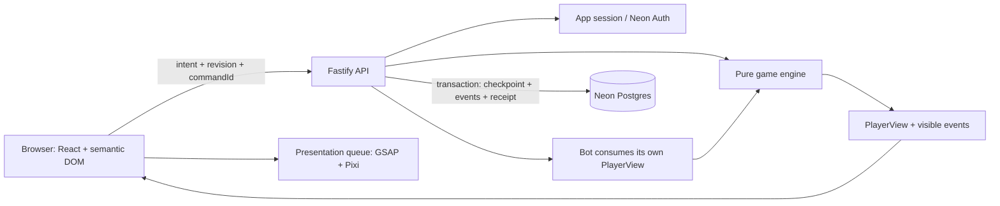

# Kiến trúc kỹ thuật

Baseline PvE online, không websocket/PvP. Quyết định kiến trúc của người thiết kế dựa trên yêu cầu được duyệt; không phải hệ thống đã chạy.

Hợp đồng public được cụ thể hóa ở [API-CONTRACT](API-CONTRACT.md) và JSON Schema Draft7 đi kèm. Phụ lục quy định field/enum/target/error chính xác; tài liệu này giữ vai trò kiến trúc và transaction. Không sao chép một DTO khác tên trong UI.

## Stack được chọn

| Lớp | Lựa chọn | Trách nhiệm |
|---|---|---|
| Web | React, TypeScript strict, Vite | Screen flow, semantic controls, text/card/inspect |
| Styling | CSS Modules + CSS custom-property tokens | Style riêng cho game, không cần UI framework lớn |
| Routing | React Router, browser routing | Home/hero/deck/match/history, refresh route |
| UI state | React hooks + external store theo useSyncExternalStore | Authoritative view/presentation cursor; không copy engine state vào nhiều store |
| Motion | GSAP + @gsap/react | Timeline, cancel/cleanup, reduced motion |
| Renderer | PixiJS v8 family, WebGL baseline | Unit sprite/terrain/VFX; lazy-load battle; WebGPU chưa là yêu cầu |
| API | Node.js LTS + Fastify | Auth, schema validation, match commands, persistence |
| Contract | JSON Schema + Fastify type provider | Request/response đóng; static type lấy từ schema, không hai định nghĩa lệch nhau |
| Engine/content/bot | Pure TypeScript packages | Deterministic rules; versioned manifests; legal bot decisions |
| Database | Neon Postgres + Drizzle + node-postgres | Durable checkpoint, events, deck versions, account/session |
| Identity | Neon Auth (Managed Better Auth), Google OAuth | Đăng nhập account; app tự quản lý guest và app session |
| Verification | Vitest, property tests với fast-check, Playwright | Engine, integration, visual/E2E; chạy thực tế khi implement |
| Workspace | pnpm workspaces, ESLint, formatter | Một repository; chưa cần orchestration monorepo bổ sung |

Major/minor phiên bản dependency được giải quyết ở T01 bằng một compatibility matrix và lockfile: stable releases, Node LTS còn hỗ trợ, React/@gsap/react/Pixi tương thích. Không dùng floating latest trong CI, không chọn prerelease chỉ vì docs ví dụ dùng nó. Đây là việc kiểm tương thích triển khai, không mở lại quyết định stack.

React/Vite là lựa chọn có chủ đích cho app game client. [React build tools](https://react.dev/learn/build-a-react-app-from-scratch). GSAP có hook quản lý lifecycle React; [GSAP React](https://gsap.com/resources/React/). Pixi cung cấp renderer2D; [Pixi introduction](https://pixijs.com/8.x/guides/getting-started/intro). Fastify có TypeScript và schema integration; [Fastify TypeScript](https://fastify.dev/docs/latest/Reference/TypeScript/).

## Luồng tổng thể



Engine có thể chạy trong simulation/test mà không DB/network. Browser chỉ import public contracts/catalog và public-preview module, không import server match state, RNG setup hay bot-private helpers. `game-content` công khai các định nghĩa, không assignment/deck order của match.

## Bố cục dự kiến khi bắt đầu implement

Các đường dẫn dưới đây là **kế hoạch**, hiện chưa tạo mã sản phẩm:

```text
apps/web/src/
  app/                         routing, error boundary, settings
  features/hero/               selection, power inspect
  features/deck/               builder, validation feedback
  features/match/              UI, view store, intent controller
  features/match/rendering/    Pixi scene, sprite registry
  features/match/motion/       GSAP timeline adapters
  features/auth/               guest/Google/session bridge
  features/history/           results, history, resume
  styles/                     tokens, font faces
apps/api/src/
  app.ts                      route/plugin registration
  auth/                       session, OAuth exchange, guest claim
  matches/                    service, repository, command handler
  decks/                      ownership and deck versions
  content/                    immutable release registry
  maintenance/                retention, diagnostics
packages/contracts/src/       public schemas, DTOs, action unions
packages/game-engine/src/     model, RNG, effects, phases, combat, projection
packages/game-content/src/    core manifests, validator, decks
packages/bot/src/             view-only evaluation, policies
packages/db/src/              Drizzle schema, migrations, connection
tests/fixtures/               deterministic scenario definitions
tests/e2e/                    browser flows
```

## Engine interfaces (hợp đồng, không implementation)

- `createMatch(config: MatchConfig, random: RandomStreams): MatchState`
- `getLegalActions(state: MatchState, actor: PlayerId): LegalAction[]`
- `applyAction(state: MatchState, action: PlayerAction): TransitionResult`
- `advanceAutomatic(state: MatchState, budget: AdvanceBudget): TransitionResult`
- `projectPlayerView(state: MatchState, viewer: PlayerId): PlayerView`
- `projectEvents(events: GameEvent[], viewer: PlayerId): VisibleEvent[]`
- `previewPublicAction(view: PlayerView, action: PlayerAction): PublicPreview`
- `chooseBotAction(view: PlayerView, legal: LegalAction[], context: BotContext): BotDecision`
- `validateDeck(deck: DeckInput, catalog: Catalog): DeckValidation`

`TransitionResult` gồm nextState, ordered events, waitingForInput và terminalOutcome; lỗi validation trả `ActionError`, không nextState bị mutate. `PlayerId` = EVIL/GOOD; LaneId=1..5; side gắn hero, không dùng firstPlayer/secondPlayer mơ hồ.

`BotDecision` gồm action và nextBotRandomState; handler persist RNG mới cùng action, không để bot mutate context bên ngoài transaction. Thường giữ nguyên bot RNG; Dễ tiến substream riêng.

`MatchState` có turn/phase, hero states, energy, hand/deck/discard, unit instances/modifiers, Location assignment, separate RNG streams, trigger counters, pending block response, automatic continuation, eventSeq. Không chứa socket/UI objects/DB handles/timestamps ảnh hưởng game rules.

`PlayerView` có public snapshot và own hand/reserve. Opponent hand/reserve chỉ count; deck chỉ count; hidden Location chỉ state/revealTurn. Viewer/owner được server lấy từ session và match membership, không tin query playerId.

## Checkpoint và command transaction

Mỗi command gồm UUID `commandId`, `expectedRevision`, action payload (hoặc ADVANCE/PAUSE/RESUME). Một revision cho một request đã commit có thay đổi match; event sequence tăng cho từng event bên trong. `sequence` của event và `revision` của checkpoint không đồng nhất.

1. Authenticate + kiểm CSRF/rate/body schema trước transaction.
2. Begin DB transaction; lock match row `FOR UPDATE`; kiểm human principal ownership. Create match khóa principal trước để bảo đảm một active match.
3. Kiểm receipt `(principalId,commandId)`: cùng hash payload trả lại receipt; khác payload trả409 IDEMPOTENCY_CONFLICT. Kiểm receipt trước expectedRevision.
4. Nếu mới và expectedRevision khác hiện tại: trả409 STALE_REVISION + view mới, không chơi action. Client resync, không tự áp lại action lên target mới.
5. Thực thi pure transition. Request PLAY/PASS chạy đúng root của người; không âm thầm chạy hết bot phase. Nếu còn automatic work, trả needsAdvance.
6. ADVANCE chạy tối đa8 automatic actions hoặc250ms CPU (DECKS), dừng ở human input, block response của người, terminal, hoặc budget. Mỗi root luôn hoàn thành trước checkpoint; không cắt giữa damage batch.
7. Ghi checkpoint mới, ordered action journal, events, receipt, result summary nếu có trong cùng transaction; commit trước response. Journal gồm human/bot intents và từng automatic root đã chạy, không chỉ ADVANCE request có budget thời gian. Không gọi network/asset/auth provider trong lúc giữ match lock.
8. Chỉ serialize view/events đã redact. Nếu commit thành công nhưng response mất, retry cùng ID/payload trả cùng receipt; client không lùi từ revision mới hơn về receipt cũ.

Không lưu match chỉ trong RAM. API restart/load-balanced instance đều đọc durable checkpoint. Bot decisions được ghi như action với ID nội bộ ổn định từ match/event sequence để replay. Seed và RNG state tiến trong cùng checkpoint transaction nên retry sau rollback tạo đúng cùng kết quả.

Replay đọc initialization và journal theo stepSeq; dùng bot action đã ghi, không gọi lại policy. Row BOT lưu cả `nextBotRandomState`; replay kiểm pre hash, apply action và restore RNG đó nguyên tử trước khi kiểm post hash. Nếu bỏ RNG transition, bot Dễ sẽ lệch state hash và các lựa chọn sau resume dù action trước đó giống nhau. CPU budget chỉ quyết định cắt batch HTTP tại đâu, không đổi thứ tự root journal hoặc kết quả game.

## Animation và automatic advancement

Web gọi ADVANCE tuần tự khi needsAdvance=true, chưa pause và không có request in-flight. Không polling liên tục để mô phỏng frame. Sau mỗi response, store authoritative snapshot, enqueue visible events; UI xử lý theo UI-MOTION. ADVANCE retry dùng lại commandId khi chưa biết kết quả. Sau409 phải lấy state mới trước tạo intent khác.

Nếu tab khác cùng tài khoản đang chơi, optimistic revision + DB lock bảo vệ state. Tab không chủ động tương tác GET snapshot mỗi5s khi đang nhìn trận; tab ẩn dừng polling. Một tab tạo action khiến tab còn lại resync; không cho timeline cũ ghi đè view mới.

## API v1

Tất cả route JSON dưới `/api/v1`, ngoại trừ health. Private response `Cache-Control: no-store`.

| Method / route | Input chính | Output / semantics |
|---|---|---|
| POST /guest | commandId + recoverySecret random256-bit | Guest principal + app session cookie + CSRF token; recovery giới hạn5 phút |
| GET /session | session cookie | Principal public info, csrf token, expiry; không raw token/secret |
| POST /auth/exchange | Neon JWT + commandId, CSRF nếu đã có session | Xác thực identity, tạo account app session |
| POST /auth/claim-guest | Neon JWT + commandId + conflict choice nếu có | Chuyển/merge dữ liệu guest theo DATA |
| POST /auth/logout | CSRF | Thu hồi app session; client signOut provider |
| GET /catalog/:version | public | Public definitions/checksum, không match data |
| GET /decks | pagination | Deck của principal + preset catalog |
| POST /decks | name, heroId, entries, version, commandId | Draft/valid deck mới |
| PUT /decks/:id | expectedDeckRevision + payload + commandId | Deck version bất biến mới;409 nếu stale |
| POST /matches | deckId/deckRevision hoặc presetId, opponentHeroId, difficulty, commandId | Match MULLIGAN;409 nếu đã có active match |
| GET /matches/:id | session | Latest PlayerView, revision, latestSeq, needsAdvance |
| GET /matches/:id/summary | session | MatchSummary của owner, giữ được sau khi checkpoint hết retention |
| GET /matches/:id/events | afterSeq≥0, throughSeq, limit≤100 | Visible events được redact, nextCursor, scannedThroughSeq, hasMore |
| POST /matches/:id/commands | commandId, expectedRevision, action | View + visible events + revision + needsAdvance |
| GET /matches | cursor, limit≤20 | History/result của chính principal |
| GET /health/live | none | Process alive; không chạm DB |
| GET /health/ready | none | DB reachable và versions hỗ trợ; không secret |

Commands: MULLIGAN(cardInstanceIds), PLAY_UNIT(instance,lane), PLAY_TRICK(instance,targets), USE_POWER(instance,targets), PASS_PHASE, USE_BLOCK_POWER(instance,targets), KEEP_BLOCK_POWER, ADVANCE, PAUSE, RESUME, SURRENDER. Owner xác định từ session. Match start tutorial là mode riêng, không cho client tự cung seed/override state.

Tên field wire chính xác là `cardInstanceId/powerInstanceId` và union `target` trong API-CONTRACT. Ba control bổ sung chỉ cho tutorial: TUTORIAL_CONTINUE(stepId), TUTORIAL_RESTART(chapterId), TUTORIAL_SKIP. JSON create tutorial chỉ nhận scenarioId đã đăng ký; setup do server đọc manifest.

Lỗi chuẩn:401 SESSION_EXPIRED;403 FORBIDDEN/CSRF;404 NOT_FOUND (không tiết lộ match của người khác);409 STALE_REVISION/ACTIVE_MATCH_EXISTS/IDEMPOTENCY_CONFLICT;422 ILLEGAL_ACTION/INVALID_DECK;429 RATE_LIMITED;503 TEMPORARILY_UNAVAILABLE;500 INTERNAL with requestId. UI giữ lựa chọn/draft khi thích hợp.

Mã lỗi đầy đủ và payload nằm trong API-CONTRACT, gồm STALE_DECK_REVISION, MERGE_MATCH_CONFLICT, LOG_EXPIRED và MATCH_DETAILS_EXPIRED. Full checkpoint hết hạn trả410; summary endpoint không bịa PlayerView từ result gọn.

## Identity, guest và cookie

Neon Auth làm Google login. Production cần OAuth app riêng và trusted origins; phát hành phải kiểm callback thật. [Neon OAuth](https://neon.com/docs/auth/guides/setup-oauth).

Browser dùng Neon SDK lấy JWT rồi exchange ở backend; backend kiểm EdDSA signature qua JWKS, expiry, `sub` và issuer **origin** của Auth URL theo docs, không mặc định issuer là toàn URL có path. [Neon JWT](https://neon.com/docs/auth/guides/plugins/jwt).

Backend phát opaque app-session token random256-bit; DB chỉ lưu SHA-256 token. Cookie `__Host-ngulo-session`, Secure, HttpOnly, SameSite=Lax, Path=/, không Domain. V1 phục vụ app và `/api` cùng origin; Vite dev dùng API proxy. CSRF token theo session + kiểm Origin trên mutation; token trong response session không bị cache.

Login khi đang là guest phải gọi **claim-guest trước**, không exchange làm mất cookie guest. Login không có guest dùng exchange. Claim/exchange là hai đường vào loại trừ nhau trong một lần login.

Auth claim commit nhưng mất response: retry cùng commandId, guest cookie cũ và JWT của cùng auth subject được phép đọc **completed claim record** dù guest session đã revoked. Quyền ngoại lệ chỉ khôi phục claim đã hoàn tất trong5 phút, không cho đọc/chơi/sửa dữ liệu bằng session revoked. Phát session account mới, revoke session phát lần trước cho claim đó; không chạy lại merge. Qua5 phút, login exchange bình thường đưa tới account đã có dữ liệu. CSRF được kiểm theo source-session record và Origin trong đường recovery.

Guest session tuyệt đối7 ngày; tài khoản app-session có hạn tuyệt đối30 ngày từ lần đăng nhập thành công, độc lập với hạn JWT của Neon. JWT vẫn phải hợp lệ tại thời điểm login và vẫn chịu giới hạn15 phút khi xác minh. Mỗi lần exchange thành công phát token ngẫu nhiên và CSRF mới, tính lại30 ngày, đồng thời revoke source-session nhận diện được của trình duyệt. Cookie cũ không còn hợp lệ/không có trong DB không chặn exchange bằng danh tính mới đã xác minh và không được dùng để nhận dữ liệu guest. Source-session nhận diện được vẫn bắt buộc CSRF và không cho đổi account hay bỏ qua claim guest. Phiên trên thiết bị khác không bị thu hồi bởi lần login này. SDK lo provider session restore; refresh lỗi thì pause và cho login lại, không mất trận. Logout revoke app session ngay; không tuyên bố mọi Neon JWT đã phát lập tức bị thu hồi.

Không dùng `getAnonymousToken()` của Neon làm guest account; guest là principal ứng dụng. Không mở Data API trực tiếp từ browser.

POST /guest chưa có cookie dùng commandId trong browser và idempotency receipt: nếu response mất, retry cùng ID tạo lại cookie cho cùng principal, không thêm guest. Receipt recovery gắn một recovery secret random256-bit client tạo riêng cho request và gửi HTTPS (hash lưu server); biết commandId thôi không đủ lấy session. Secret chỉ giữ tạm cho đến nhận cookie, không dùng như token chơi game. Login exchange cần JWT hợp lệ, nên retry có thể phát lại session cho cùng account mà không tạo principal khác.

## Khôi phục battle log

GET match trả snapshot tại latestSeq=N. Client lấy event pages `afterSeq=cursor&throughSeq=N`; server authorize owner, lọc OWNER theo side, bỏ SERVER. Cursor là **seq cuối đã scan**, không phải seq cuối được nhìn thấy, nên page toàn event private không làm vòng lặp vô hạn. Không trả payload/loại của event bị ẩn.

Log store deduplicate theo eventId, nối tới N; animation chỉ dùng event mới còn trong budget, backlog/resume không phát lại toàn bộ VFX. Snapshot là state truth, event recovery phục vụ log. Nếu hết retention, trả410 LOG_EXPIRED kèm earliestAvailableSeq; UI ghi phần nhật ký đã hết hạn, không bịa lại. Active match giữ logs nên resume trong thời hạn không bị mất log.

## Hosting và kết nối

Một Render Node web service phục vụ Vite static build + API ở Singapore; Neon chọn AWS Singapore `aws-ap-southeast-1` nếu tạo mới. Render có Singapore và Neon liệt kê cả Postgres/Auth tại đây. [Render regions](https://render.com/docs/regions), [Neon regions](https://neon.com/docs/introduction/regions). Đây là mục tiêu thiết kế, chưa có resource/account được chọn.

API bind `0.0.0.0:$PORT`, TLS do host terminate; static assets content-hashed cache immutable, index.html revalidate, API no-store. Database không chứa binary art, chỉ asset keys/checksums. Bộ asset versioned nằm trong build/CDN; chưa cần object upload service.

Drizzle dùng `pg.Pool` tái sử dụng, max5 connection mỗi API instance ban đầu, application pooled URL; migration dùng direct URL và role riêng. [Drizzle Neon](https://orm.drizzle.team/docs/connect-neon), [Neon pooling](https://neon.com/docs/connect/connection-pooling).

Không Redis, websocket, Colyseus, LLM API, queues hay filesystem snapshot ở v1. Không dùng `LISTEN/NOTIFY` hoặc session advisory locks qua PgBouncer; transaction row lock đủ cho PvE.

## Vận hành và ranh giới phát hành

Structured logs: requestId, matchId, revision, action kind, duration và error code. Không raw request auth header, hand/deck/seed/receipt payload. Diagnostic đầy đủ chỉ ở DB riêng được phân quyền.

Limit đề xuất: body≤32KB; commands≤120/phút/principal, create≤10 trận/giờ/principal; rate limiter instance-local ở beta1instance, DB uniqueness bảo vệ correctness. Tăng instance phải thiết kế rate-limit chung trước. Query timeout3s, command deadline5s; quá hạn trả trạng thái chưa biết và client kiểm/retry cùng ID.

Load target beta20 trận đồng thời; response p95≤500ms cho action người trong điều kiện warm cùng vùng, cold-start đo riêng; auto batch≤1s wall target. Đây là SLO thử nghiệm, chưa đo.

Không deploy tự động từ việc viết tài liệu. Trước triển khai thật: kiểm gói/giá, account, region, secrets, DB migration preview, OAuth callback và ngân sách. Rollback app chỉ an toàn nếu schema tương thích và tất cả rulesVersion của active matches còn được runtime hỗ trợ.
