# OathFront — fourteen new heroes

**Playable in `heroes_v1`.** These fourteen original identities now extend the original six to twenty playable heroes. Each has a four-power kit, a signature and a legal starter preset. All twenty illustrations and the Home banner have been redesigned together; see the [current art guide](../heroes-v4.md). The sixty existing cards are preserved. `core_v1` remains immutable for older matches and tutorials.

The descriptions, illustrations and prompts below preserve the initial design package. Current runtime art is in `heroes-v4`; `roster.json` records both current and historical paths.

[Open the visual gallery](gallery.html) locally in a browser, or browse the images below. [Machine-readable roster](roster.json), [exact generation prompts](prompts.json), [asset manifest](../../../assets/source/heroes-expansion-v1/manifest.json), [scope and rule semantics](../../superpowers/specs/2026-10-22-hero-expansion-design.md).

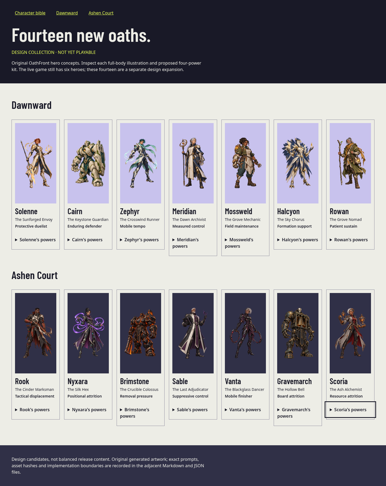

## Direction and constraints

The art uses angular comic fantasy, strong body shapes, readable equipment and faction-specific materials. The [official Marvel Rivals website](https://www.marvelrivals.com/) and [hero presentation](https://www.marvelrivals.com/heroes/index.html) informed presentation and heroic shape language; all characters here are original OathFront concepts, with no imported Marvel art, names or logos. Artwork was generated with the built-in image tool and saved in this repository.

Dawnward favors ivory, navy, natural greens and brass; Ashen Court favors charcoal, ember, plum and weathered metal. Faces, ages, builds and human/nonhuman silhouettes vary deliberately. Final images are 1024×1536 RGBA PNGs. The generator did not consistently deliver the requested 8% empty margin, but inspected solid-alpha bounds stay inside every image. Place them in a padded contain frame; never stretch or blindly crop equipment.

The proposed heroes use existing classes and 20 HP. Each has three existing powers and a unique signature costing 1 energy. Held powers use GOOD_PLAY / EVIL_TRICKS; the existing just-earned BLOCK_RESPONSE exception remains unchanged. Four powers means four pool entries, not four always-available buttons or extra hero passives. Candidate values require balance testing.

## Roster

| Hero | Faction | Classes | Role | Signature |
| --- | --- | --- | --- | --- |
| [Solenne](#solenne) | Dawnward | BASTION / PRISM | Protective duelist | Solar Accord |
| [Cairn](#cairn) | Dawnward | BASTION / VERDANT | Enduring defender | Keystone Covenant |
| [Zephyr](#zephyr) | Dawnward | VERDANT / PRISM | Mobile tempo | Crosswind |
| [Meridian](#meridian) | Dawnward | BASTION / PRISM | Measured control | Held Dawn |
| [Mossweld](#mossweld) | Dawnward | BASTION / VERDANT | Field maintenance | Field Refit |
| [Halcyon](#halcyon) | Dawnward | VERDANT / PRISM | Formation support | Skyward Chorus |
| [Rowan](#rowan) | Dawnward | BASTION / VERDANT | Patient sustain | Hearthroot |
| [Rook](#rook) | Ashen Court | FURNACE / VEIL | Tactical displacement | Crossfire Oath |
| [Nyxara](#nyxara) | Ashen Court | HEX / VEIL | Positional attrition | Thread the Needle |
| [Brimstone](#brimstone) | Ashen Court | FURNACE / HEX | Removal pressure | Crucible Break |
| [Sable](#sable) | Ashen Court | HEX / VEIL | Suppressive control | Final Injunction |
| [Vanta](#vanta) | Ashen Court | FURNACE / VEIL | Mobile finisher | Blackglass Waltz |
| [Gravemarch](#gravemarch) | Ashen Court | FURNACE / HEX | Board attrition | Toll of Cinders |
| [Scoria](#scoria) | Ashen Court | FURNACE / HEX | Resource attrition | Ashen Remedy |

## Shared powers

The following twelve existing powers fill forty-two kit slots. Fourteen unique signatures fill the remaining fourteen slots. These summaries preserve existing mechanics; the runtime English content and immutable core definitions remain authoritative.

| ID | Name | Effect |
| --- | --- | --- |
| `P_B1` | Dawn Shield | Give an allied unit Shield. Draw a card. |
| `P_B2` | Mend Armor | Heal an allied unit for 4. Draw a card. |
| `P_V1` | Resilient Seed | Give an allied unit +0/+2 permanently. Draw a card. |
| `P_V2` | Forest Breath | Heal your hero for 3 and all allied units for 1. |
| `P_P1` | Mirrorstep | Move an allied unit to an empty allied lane. Give it +1 ATK this turn. |
| `P_P2` | Silent Flash | Stun an enemy unit this turn. Draw a card. |
| `P_F1` | Ember | Deal 2 damage to an enemy unit or hero. |
| `P_F2` | Temper Blade | Give an allied unit +2 ATK this turn and Shield. |
| `P_X1` | Venom Ink | Deal 1 damage to an enemy unit, then Poison it. |
| `P_X2` | Reclaim Vitality | Heal your hero for 2. Draw a card. |
| `P_S1` | False Path | Move an enemy unit to an empty lane on its side. |
| `P_S2` | Night Mantle | Give an allied unit Shield and +1 ATK this turn. |

## Solenne

**The Sunforged Envoy** · Dawnward · BASTION / PRISM · Protective duelist

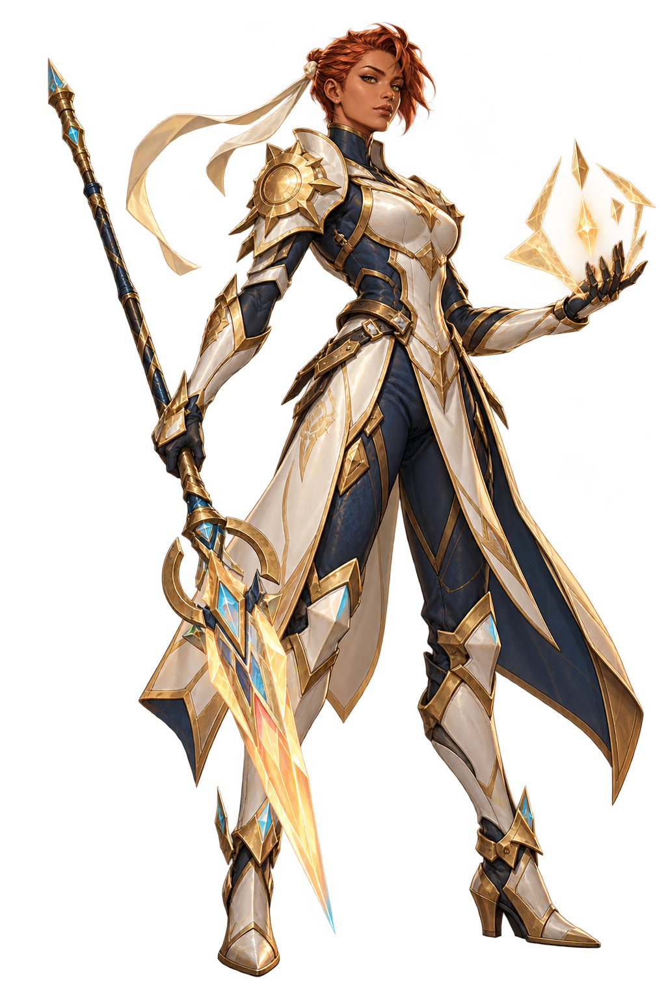

A treaty keeper who carries a ward instead of a crown. Solenne holds a contested lane long enough for reinforcements to arrive.

**Visual identity:** slender spear triangle; ivory, navy, copper gold. The exact equipment and materials are defined in [the prompt set](prompts.json).

**Four-power kit:**

- **Dawn Shield** (`P_B1`): Give an allied unit Shield. Draw a card.
- **Mirrorstep** (`P_P1`): Move an allied unit to an empty allied lane. Give it +1 ATK this turn.
- **Silent Flash** (`P_P2`): Stun an enemy unit this turn. Draw a card.
- **Solar Accord — Signature, 1 energy:** Give an allied unit Shield and +1/+1 permanently.

**Target:** `ALLY_UNIT`. **Resolution:** SHIELD target → BUFF target +1 ATK +1 maxHP PERMANENT.

**Play pattern:** Protect a valuable unit, then move it away from unfavorable exchanges.

**Counterplay:** Hard removal and wide pressure punish investment in one unit.

**Starter template:** `D_G_BP`, an existing legal 30-card deck with the same two classes. This is a baseline for later tuning, not an independently optimized new deck.

**Playable identifiers in `heroes_v1`:** `H_G_SOL`, `S_G_SOL`.

## Cairn

**The Keystone Guardian** · Dawnward · BASTION / VERDANT · Enduring defender

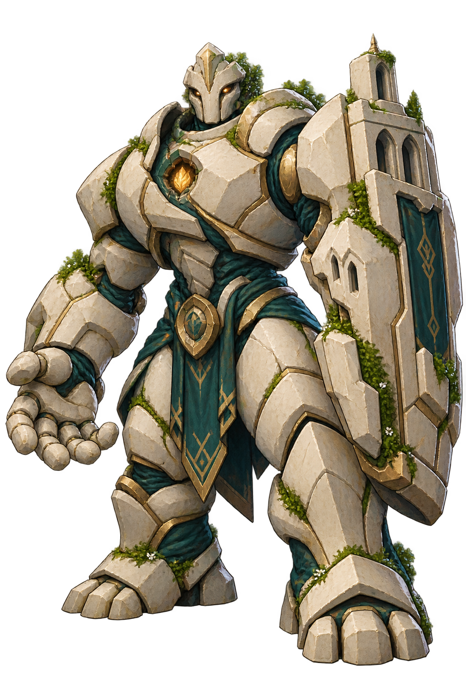

Built to shelter a city, Cairn now walks the Fivefold carrying its last living seed.

**Visual identity:** broad stone arch; limestone, moss teal, gold. The exact equipment and materials are defined in [the prompt set](prompts.json).

**Four-power kit:**

- **Dawn Shield** (`P_B1`): Give an allied unit Shield. Draw a card.
- **Mend Armor** (`P_B2`): Heal an allied unit for 4. Draw a card.
- **Resilient Seed** (`P_V1`): Give an allied unit +0/+2 permanently. Draw a card.
- **Keystone Covenant — Signature, 1 energy:** Give an allied unit Armor and +0/+2 permanently.

**Target:** `ALLY_UNIT`. **Resolution:** ARMOR target → BUFF target +0 ATK +2 maxHP PERMANENT.

**Play pattern:** Build a durable blocker and force the opponent to spend more than one card answering it.

**Counterplay:** Movement and effects that destroy units directly bypass a defensive stat advantage.

**Starter template:** `D_G_BV`, an existing legal 30-card deck with the same two classes. This is a baseline for later tuning, not an independently optimized new deck.

**Playable identifiers in `heroes_v1`:** `H_G_CAI`, `S_G_CAI`.

## Zephyr

**The Crosswind Runner** · Dawnward · VERDANT / PRISM · Mobile tempo

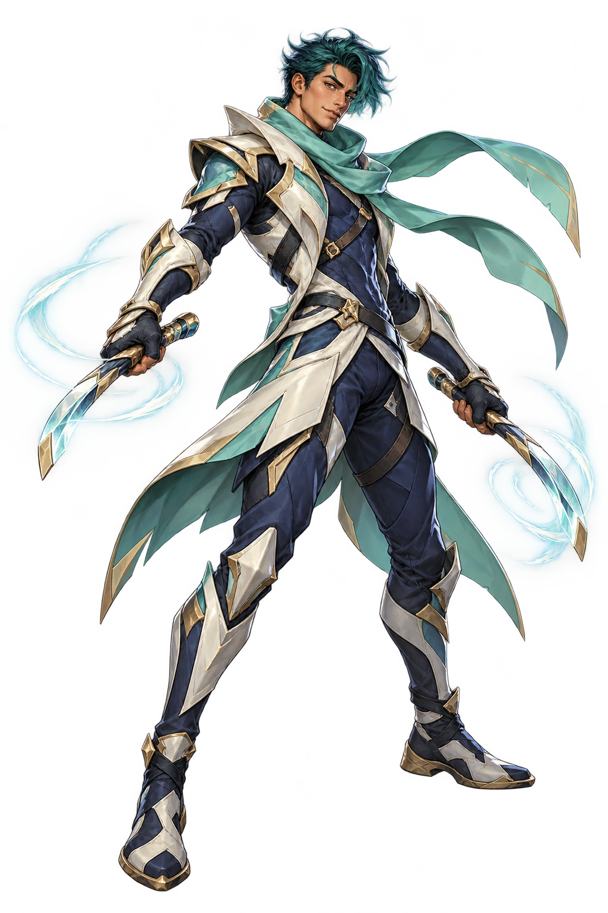

A courier who reads the broken winds between lanes. Zephyr wins by arriving where the enemy has stopped looking.

**Visual identity:** lean scarf diagonal; ivory, seafoam, indigo. The exact equipment and materials are defined in [the prompt set](prompts.json).

**Four-power kit:**

- **Resilient Seed** (`P_V1`): Give an allied unit +0/+2 permanently. Draw a card.
- **Forest Breath** (`P_V2`): Heal your hero for 3 and all allied units for 1.
- **Mirrorstep** (`P_P1`): Move an allied unit to an empty allied lane. Give it +1 ATK this turn.
- **Crosswind — Signature, 1 energy:** Move an allied unit to an empty allied lane. Give it +3 ATK this turn. Draw a card.

**Target:** `ALLY_UNIT_AND_EMPTY_ALLIED_LANE`. **Resolution:** MOVE target to destination → BUFF target +3 ATK UNTIL_TURN_END → DRAW self 1.

**Play pattern:** Preserve a healthy unit and reposition it into an open attack lane.

**Counterplay:** Full allied boards restrict movement; Stun interrupts a planned attack.

**Starter template:** `D_G_VP`, an existing legal 30-card deck with the same two classes. This is a baseline for later tuning, not an independently optimized new deck.

**Playable identifiers in `heroes_v1`:** `H_G_ZEP`, `S_G_ZEP`.

## Meridian

**The Dawn Archivist** · Dawnward · BASTION / PRISM · Measured control

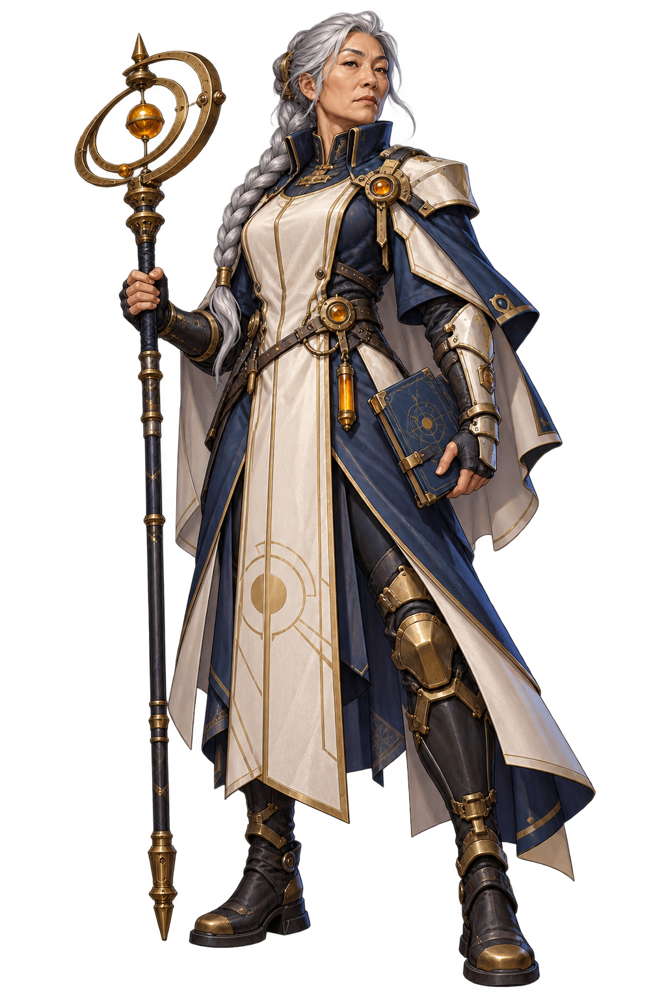

Meridian records the promises that survive each war. Her astronomical instruments guide precise interventions; they do not rewind time.

**Visual identity:** straight scholar rectangle; navy, ivory, amber brass. The exact equipment and materials are defined in [the prompt set](prompts.json).

**Four-power kit:**

- **Mend Armor** (`P_B2`): Heal an allied unit for 4. Draw a card.
- **Mirrorstep** (`P_P1`): Move an allied unit to an empty allied lane. Give it +1 ATK this turn.
- **Silent Flash** (`P_P2`): Stun an enemy unit this turn. Draw a card.
- **Held Dawn — Signature, 1 energy:** Stun an enemy unit this turn. Heal your hero for 3. Draw a card.

**Target:** `ENEMY_UNIT`. **Resolution:** STUN target UNTIL_TURN_END → HEAL selfHero 3 → DRAW self 1.

**Play pattern:** Delay a large attacker while restoring resources and finding your next answer.

**Counterplay:** Multiple threats outpace a single Stun; Stun does not remove blockers or triggers.

**Starter template:** `D_G_BP`, an existing legal 30-card deck with the same two classes. This is a baseline for later tuning, not an independently optimized new deck.

**Playable identifiers in `heroes_v1`:** `H_G_MER`, `S_G_MER`.

## Mossweld

**The Grove Mechanic** · Dawnward · BASTION / VERDANT · Field maintenance

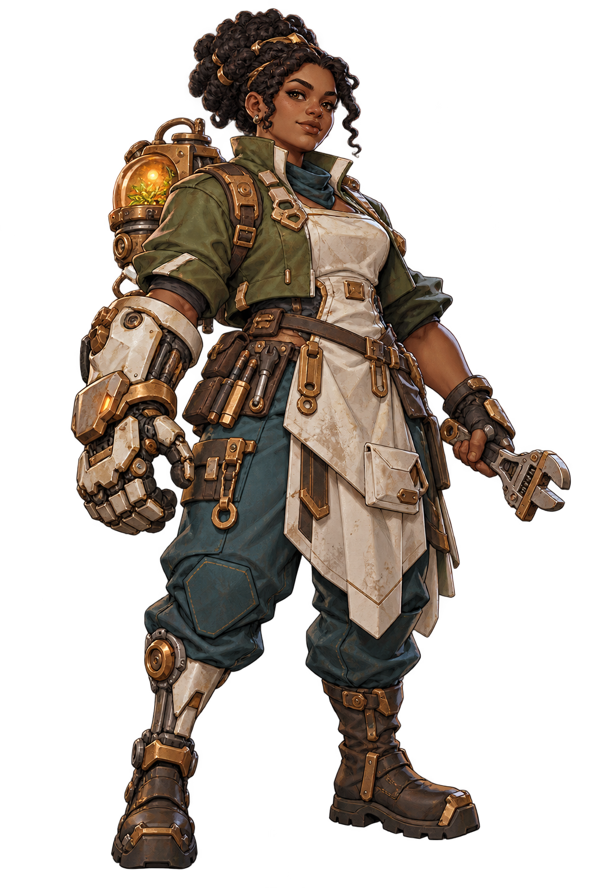

Mossweld rebuilds what the front line leaves behind. Her seed kiln joins living fibers to practical machinery.

**Visual identity:** compact gauntlet asymmetry; olive, ivory, copper, teal. The exact equipment and materials are defined in [the prompt set](prompts.json).

**Four-power kit:**

- **Dawn Shield** (`P_B1`): Give an allied unit Shield. Draw a card.
- **Mend Armor** (`P_B2`): Heal an allied unit for 4. Draw a card.
- **Forest Breath** (`P_V2`): Heal your hero for 3 and all allied units for 1.
- **Field Refit — Signature, 1 energy:** Heal an allied unit for 4. Give it Shield. Draw a card.

**Target:** `ALLY_UNIT`. **Resolution:** HEAL target 4 → SHIELD target → DRAW self 1.

**Play pattern:** Repair a damaged survivor before the next exchange and retain card advantage.

**Counterplay:** Full-health targets waste the heal; direct destruction ignores repaired HP.

**Starter template:** `D_G_BV`, an existing legal 30-card deck with the same two classes. This is a baseline for later tuning, not an independently optimized new deck.

**Playable identifiers in `heroes_v1`:** `H_G_MOS`, `S_G_MOS`.

## Halcyon

**The Sky Chorus** · Dawnward · VERDANT / PRISM · Formation support

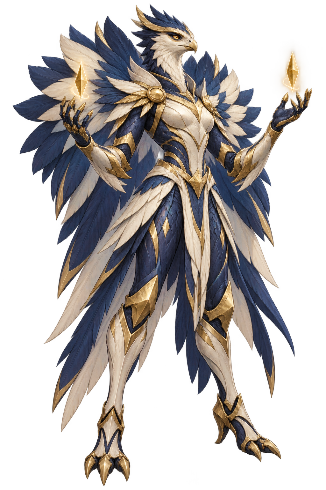

The last cantor of an airborne sanctuary, Halcyon coordinates scattered allies through resonant crystal tones.

**Visual identity:** tall avian feather fan; ivory, indigo, pale gold. The exact equipment and materials are defined in [the prompt set](prompts.json).

**Four-power kit:**

- **Forest Breath** (`P_V2`): Heal your hero for 3 and all allied units for 1.
- **Mirrorstep** (`P_P1`): Move an allied unit to an empty allied lane. Give it +1 ATK this turn.
- **Silent Flash** (`P_P2`): Stun an enemy unit this turn. Draw a card.
- **Skyward Chorus — Signature, 1 energy:** Give all allied units +1 ATK this turn and heal them for 1.

**Target:** `NONE`. **Resolution:** BUFF ALL_ALLIED_UNITS +1 ATK UNTIL_TURN_END → HEAL ALL_ALLIED_UNITS 1.

**Play pattern:** Develop several lanes before using a formation-wide combat boost.

**Counterplay:** Board wipes and thin allied boards reduce the signature's value.

**Starter template:** `D_G_VP`, an existing legal 30-card deck with the same two classes. This is a baseline for later tuning, not an independently optimized new deck.

**Playable identifiers in `heroes_v1`:** `H_G_HAL`, `S_G_HAL`.

## Rowan

**The Grove Nomad** · Dawnward · BASTION / VERDANT · Patient sustain

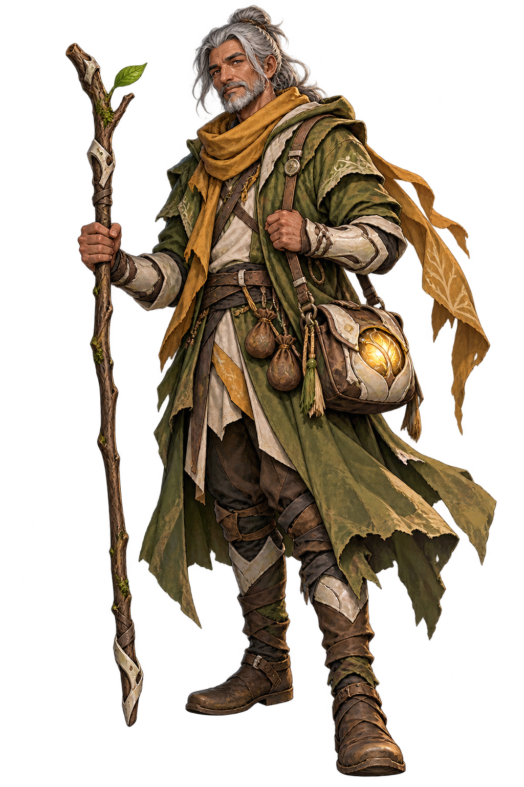

Rowan carries seeds from settlements that no longer stand. Each camp he leaves behind becomes a small refuge.

**Visual identity:** staff and layered traveling coat; moss, ochre, ivory, brown. The exact equipment and materials are defined in [the prompt set](prompts.json).

**Four-power kit:**

- **Mend Armor** (`P_B2`): Heal an allied unit for 4. Draw a card.
- **Resilient Seed** (`P_V1`): Give an allied unit +0/+2 permanently. Draw a card.
- **Forest Breath** (`P_V2`): Heal your hero for 3 and all allied units for 1.
- **Hearthroot — Signature, 1 energy:** Summon a Seedling in an empty allied lane. Heal your hero for 4.

**Target:** `EMPTY_ALLIED_LANE`. **Resolution:** SUMMON TK_G_SEED at destination → HEAL selfHero 4.

**Play pattern:** Stabilize a losing board with a blocker while recovering hero health.

**Counterplay:** A full board prevents the summon; sustained pressure can overwhelm a small token.

**Starter template:** `D_G_BV`, an existing legal 30-card deck with the same two classes. This is a baseline for later tuning, not an independently optimized new deck.

**Playable identifiers in `heroes_v1`:** `H_G_ROW`, `S_G_ROW`.

## Rook

**The Cinder Marksman** · Ashen Court · FURNACE / VEIL · Tactical displacement

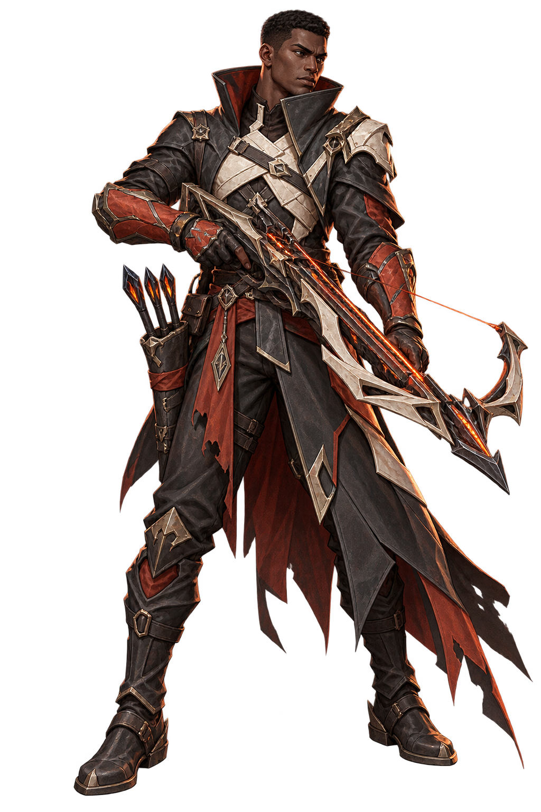

Rook tracks the gaps between defensive lines. A single redirected target is often enough to open the route forward.

**Visual identity:** rail-bow diagonal; charcoal, rust, bone, ember. The exact equipment and materials are defined in [the prompt set](prompts.json).

**Four-power kit:**

- **Ember** (`P_F1`): Deal 2 damage to an enemy unit or hero.
- **Temper Blade** (`P_F2`): Give an allied unit +2 ATK this turn and Shield.
- **False Path** (`P_S1`): Move an enemy unit to an empty lane on its side.
- **Crossfire Oath — Signature, 1 energy:** Move an enemy unit to an empty lane on its side. Deal 2 damage to it.

**Target:** `ENEMY_UNIT_AND_EMPTY_ENEMY_LANE`. **Resolution:** MOVE target to destination → DAMAGE target 2.

**Play pattern:** Move a blocker out of the lane you want to attack, then finish a weakened target.

**Counterplay:** A full enemy board denies movement; Armor and Shield reduce the follow-up damage.

**Starter template:** `D_E_FS`, an existing legal 30-card deck with the same two classes. This is a baseline for later tuning, not an independently optimized new deck.

**Playable identifiers in `heroes_v1`:** `H_E_ROO`, `S_E_ROO`.

## Nyxara

**The Silk Hex** · Ashen Court · HEX / VEIL · Positional attrition

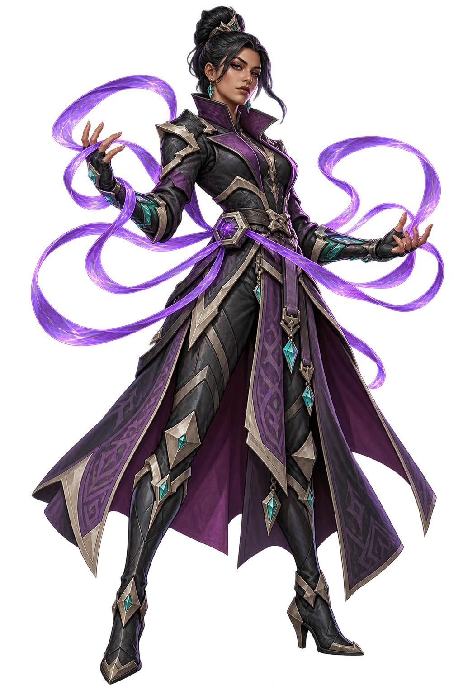

Nyxara weaves binding oaths into silent threads. Her control is patient, forcing enemies to fight on terms they did not choose.

**Visual identity:** slim coat with six ribbon strands; plum, charcoal, turquoise. The exact equipment and materials are defined in [the prompt set](prompts.json).

**Four-power kit:**

- **Venom Ink** (`P_X1`): Deal 1 damage to an enemy unit, then Poison it.
- **False Path** (`P_S1`): Move an enemy unit to an empty lane on its side.
- **Night Mantle** (`P_S2`): Give an allied unit Shield and +1 ATK this turn.
- **Thread the Needle — Signature, 1 energy:** Move an enemy unit to an empty lane on its side. Poison it.

**Target:** `ENEMY_UNIT_AND_EMPTY_ENEMY_LANE`. **Resolution:** MOVE target to destination → POISON target.

**Play pattern:** Displace durable defenders and let Poison tax them across turns.

**Counterplay:** Armor and Shield can absorb Poison packets; full lanes restrict her signature.

**Starter template:** `D_E_XS`, an existing legal 30-card deck with the same two classes. This is a baseline for later tuning, not an independently optimized new deck.

**Playable identifiers in `heroes_v1`:** `H_E_NYX`, `S_E_NYX`.

## Brimstone

**The Crucible Colossus** · Ashen Court · FURNACE / HEX · Removal pressure

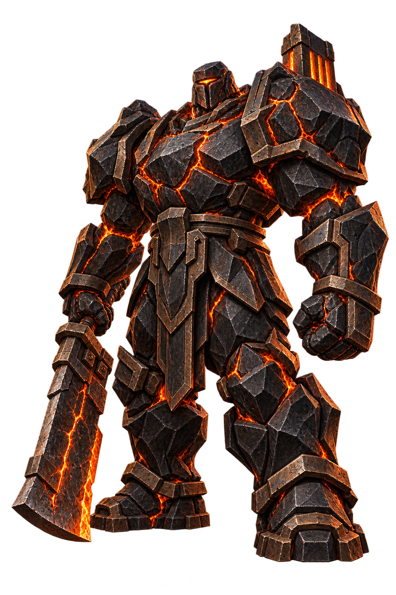

An abandoned siege furnace given purpose, Brimstone treats every fortification as ore awaiting the hammer.

**Visual identity:** heavy obsidian trapezoid; obsidian, burnt iron, ember. The exact equipment and materials are defined in [the prompt set](prompts.json).

**Four-power kit:**

- **Ember** (`P_F1`): Deal 2 damage to an enemy unit or hero.
- **Temper Blade** (`P_F2`): Give an allied unit +2 ATK this turn and Shield.
- **Reclaim Vitality** (`P_X2`): Heal your hero for 2. Draw a card.
- **Crucible Break — Signature, 1 energy:** Deal 3 damage to an enemy unit, then 1 damage to the enemy hero.

**Target:** `ENEMY_UNIT`. **Resolution:** DAMAGE target 3 → DAMAGE enemyHero 1.

**Play pattern:** Remove a medium defender while maintaining direct pressure on the enemy hero.

**Counterplay:** Shield absorbs a damage packet; efficient healing can offset the hero damage.

**Starter template:** `D_E_FX`, an existing legal 30-card deck with the same two classes. This is a baseline for later tuning, not an independently optimized new deck.

**Playable identifiers in `heroes_v1`:** `H_E_BRI`, `S_E_BRI`.

## Sable

**The Last Adjudicator** · Ashen Court · HEX / VEIL · Suppressive control

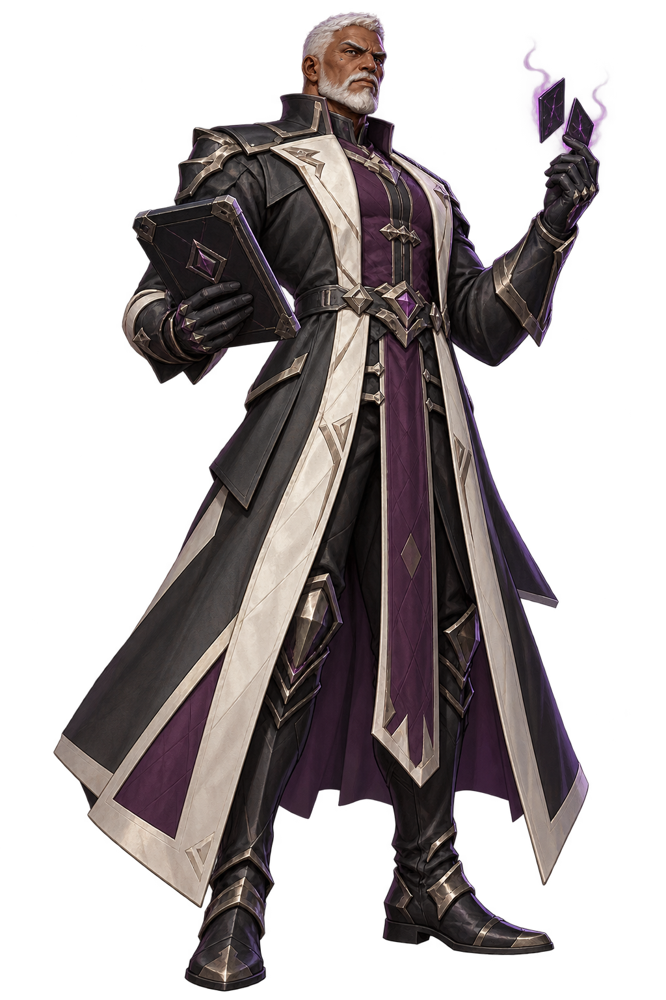

Sable enforces judgments written before the factions split. His ink seals turn powerful enemies into costly liabilities.

**Visual identity:** tall judicial rectangle; charcoal, bone, plum. The exact equipment and materials are defined in [the prompt set](prompts.json).

**Four-power kit:**

- **Reclaim Vitality** (`P_X2`): Heal your hero for 2. Draw a card.
- **False Path** (`P_S1`): Move an enemy unit to an empty lane on its side.
- **Night Mantle** (`P_S2`): Give an allied unit Shield and +1 ATK this turn.
- **Final Injunction — Signature, 1 energy:** Give an enemy unit -2 ATK this turn. Poison it. Draw a card.

**Target:** `ENEMY_UNIT`. **Resolution:** BUFF target -2 ATK UNTIL_TURN_END → POISON target → DRAW self 1.

**Play pattern:** Reduce an immediate attack and establish a longer attrition threat.

**Counterplay:** ATK penalties do not stop triggered abilities; Poison does not stack.

**Starter template:** `D_E_XS`, an existing legal 30-card deck with the same two classes. This is a baseline for later tuning, not an independently optimized new deck.

**Playable identifiers in `heroes_v1`:** `H_E_SAB`, `S_E_SAB`.

## Vanta

**The Blackglass Dancer** · Ashen Court · FURNACE / VEIL · Mobile finisher

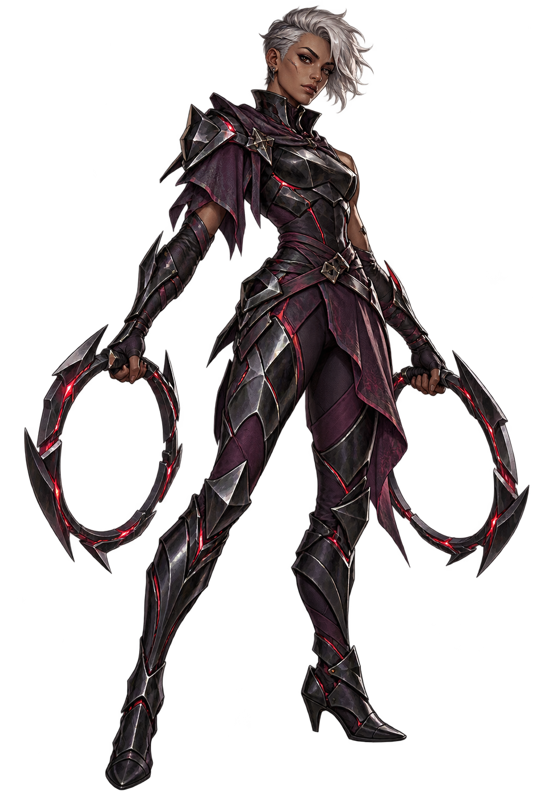

Vanta learned to move through the reflections of broken glass. Every feint conceals the angle of the final strike.

**Visual identity:** narrow S curve and blade hoops; blackglass, plum, silver, crimson. The exact equipment and materials are defined in [the prompt set](prompts.json).

**Four-power kit:**

- **Ember** (`P_F1`): Deal 2 damage to an enemy unit or hero.
- **False Path** (`P_S1`): Move an enemy unit to an empty lane on its side.
- **Night Mantle** (`P_S2`): Give an allied unit Shield and +1 ATK this turn.
- **Blackglass Waltz — Signature, 1 energy:** Move an allied unit to an empty allied lane. Give it +1 ATK and Pierce this turn.

**Target:** `ALLY_UNIT_AND_EMPTY_ALLIED_LANE`. **Resolution:** MOVE target to destination → BUFF target +1 ATK UNTIL_TURN_END → GRANT PIERCE to target UNTIL_TURN_END.

**Play pattern:** Reposition a strong attacker; Pierce adds a separate full-ATK hero packet while that unit attacks a blocker.

**Counterplay:** Stun or removal before attack declaration stops the strike; reducing the attacker’s ATK reduces both packets. A durable blocker does not absorb Pierce’s hero packet.

**Starter template:** `D_E_FS`, an existing legal 30-card deck with the same two classes. This is a baseline for later tuning, not an independently optimized new deck.

**Playable identifiers in `heroes_v1`:** `H_E_VAN`, `S_E_VAN`.

## Gravemarch

**The Hollow Bell** · Ashen Court · FURNACE / HEX · Board attrition

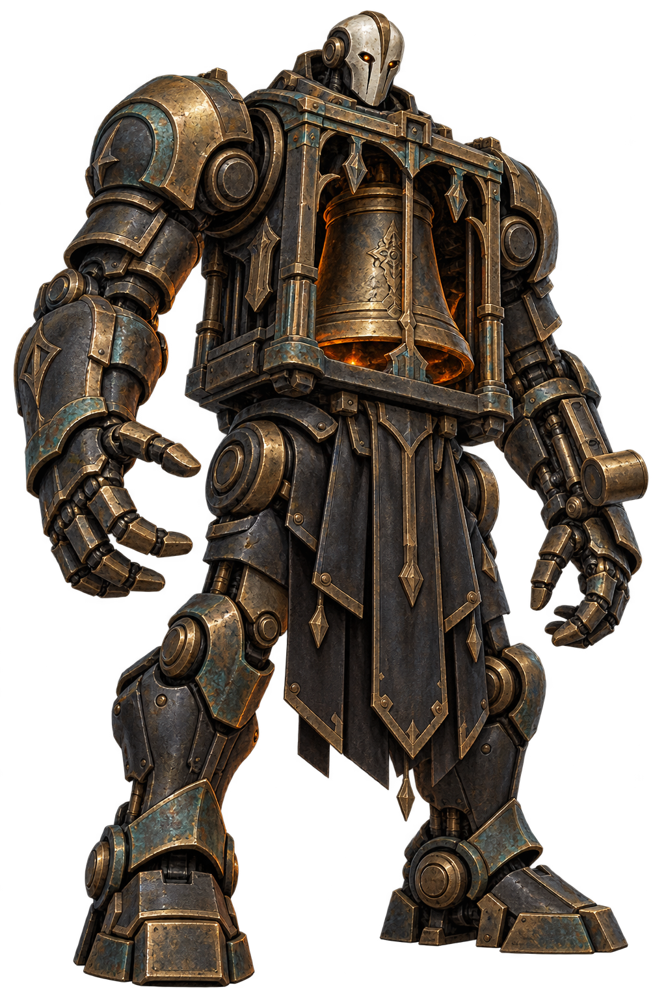

Gravemarch once announced the return of a victorious army. Now its bell calls only the embers that followed them home.

**Visual identity:** blocky bell-cage automaton; soot, bronze, teal patina. The exact equipment and materials are defined in [the prompt set](prompts.json).

**Four-power kit:**

- **Ember** (`P_F1`): Deal 2 damage to an enemy unit or hero.
- **Venom Ink** (`P_X1`): Deal 1 damage to an enemy unit, then Poison it.
- **Reclaim Vitality** (`P_X2`): Heal your hero for 2. Draw a card.
- **Toll of Cinders — Signature, 1 energy:** Summon a Cinderling in an empty allied lane. Deal 1 damage to all enemy units.

**Target:** `EMPTY_ALLIED_LANE`. **Resolution:** SUMMON TK_E_CINDER at destination → DAMAGE ALL_ENEMY_UNITS 1 IN_ONE_BATCH.

**Play pattern:** Add a body while removing fragile units or consuming enemy Shields.

**Counterplay:** Armor can negate the sweep, and a full allied board blocks the signature.

**Starter template:** `D_E_FX`, an existing legal 30-card deck with the same two classes. This is a baseline for later tuning, not an independently optimized new deck.

**Playable identifiers in `heroes_v1`:** `H_E_GRA`, `S_E_GRA`.

## Scoria

**The Ash Alchemist** · Ashen Court · FURNACE / HEX · Resource attrition

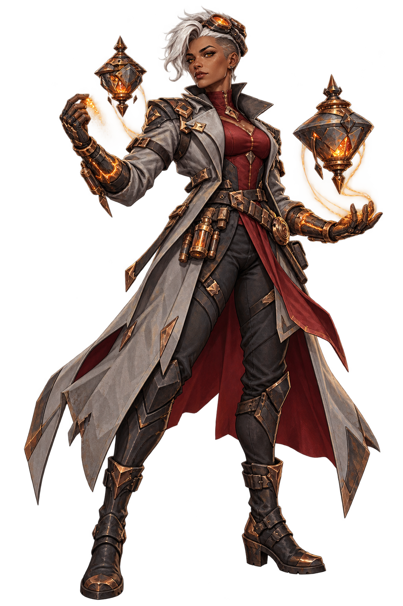

Scoria extracts useful life from the residue of battle. Her portable kilns turn controlled destruction into another chance to endure.

**Visual identity:** split laboratory coat and twin vessels; ash, charcoal, copper, crimson. The exact equipment and materials are defined in [the prompt set](prompts.json).

**Four-power kit:**

- **Temper Blade** (`P_F2`): Give an allied unit +2 ATK this turn and Shield.
- **Venom Ink** (`P_X1`): Deal 1 damage to an enemy unit, then Poison it.
- **Reclaim Vitality** (`P_X2`): Heal your hero for 2. Draw a card.
- **Ashen Remedy — Signature, 1 energy:** Deal 2 damage to an enemy unit. Heal your hero for 3. Draw a card.

**Target:** `ENEMY_UNIT`. **Resolution:** DAMAGE target 2 → HEAL selfHero 3 → DRAW self 1.

**Play pattern:** Trade against a small enemy while recovering health and maintaining hand size.

**Counterplay:** Shield and Armor weaken removal; wide boards demand more than one answer.

**Starter template:** `D_E_FX`, an existing legal 30-card deck with the same two classes. This is a baseline for later tuning, not an independently optimized new deck.

**Playable identifiers in `heroes_v1`:** `H_E_SCO`, `S_E_SCO`.

## Pen and implementation handoff

The source Pen file contains six hero profile pairs. The fourteen new profiles must be treated as derived extensions of that template; no source node IDs are invented. A future Pen update must add actual frames before mappings can be populated. See [contract addendum](../pen/DESIGN-CONTRACT.md#hero-expansion-design-addendum).

- Full-profile art must use `object-fit: contain` with outer padding. Portrait tiles should use a separately reviewed face crop, not a squeezed full figure.
- Names, classes, roles and rules must remain live text with visible focus and touch targets. Color alone must not convey faction, targeting or availability.
- The 20-hero roster must remain readable at 375px and preserve faction/class filters if introduced; selecting a hero must retain exact hero-to-deck identity.
- Signature presentation should reuse shield/growth/movement/curse/damage/summon feedback families. A tiny gold ward identifies Solenne, stone seams identify Cairn, wind strokes Zephyr, a dial pulse Meridian, repair sparks Mossweld, feather light Halcyon, seed light Rowan, a bolt Rook, silk Nyxara, forge light Brimstone, an ink seal Sable, glass Vanta, bell light Gravemarch and kiln light Scoria.
- Motion must use scoped GSAP and the current 300–480ms entrance / 160ms feedback range; game commands and results must never wait for it. Reduced motion must retain static target/highlight/text feedback.
- UI theme tokens remain paper/slate/lilac/acid. Character palettes must not overwrite semantic action/error/selection colors.
- Asset failure must preserve name, role, rules and retry affordance without layout shift.
- A playable expansion must be versioned separately. Existing core_v1 matches, decks, tutorials, history and replay records must remain readable and unchanged.

## QA and remaining acceptance

- [x] Fourteen distinct names, silhouettes, original PNGs and explicit four-power kits.
- [x] Seven heroes per faction; classes and shared powers match existing faction restrictions.
- [x] Fourteen unique proposed signatures with target and effect order.
- [x] Actual alpha, image dimensions, solid-edge bounds and source hashes inspected.
- [x] Full figures and primary props reviewed visually; silhouettes also reviewed over Pen paper/slate backgrounds in the gallery.
- [x] Rule descriptions follow existing damage, movement, Poison, Armor, Shield, token and Pierce semantics.
- [x] Playable integration approved and implemented in `heroes_v1`.
- [ ] Signature balance, fourteen tuned decks and human playtests.
- [x] Current runtime thumbnail/HUD crops reviewed in `heroes-v4`.
- [ ] New editable Pen frames (the frozen source remains unchanged).

Human balance playtests and new editable Pen frames remain open; technical integration does not certify balance.
